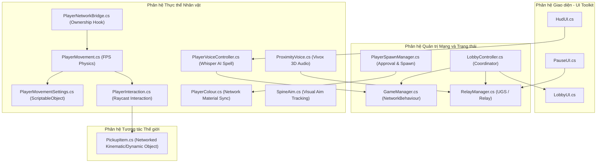
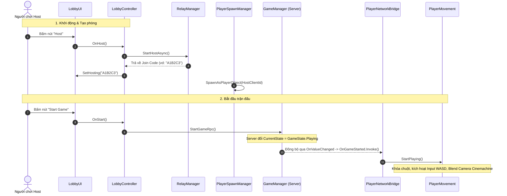
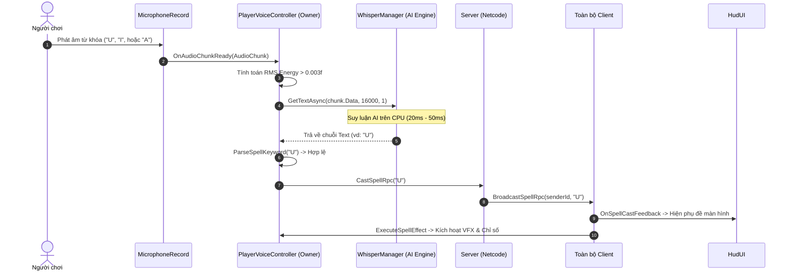

# BÁO CÁO KỸ THUẬT KIẾN TRÚC MÃ NGUỒN VÀ HỆ THỐNG
## DỰ ÁN: U6 FIRST-PERSON MULTIPLAYER

---

### MỤC LỤC
1. [TỔNG QUAN HỆ THỐNG VÀ CÔNG NGHỆ NỀN TẢNG](#1-tổng-quan-hệ-thống-và-công-nghệ-nền-tảng)
2. [SƠ ĐỒ KIẾN TRÚC TỔNG THỂ](#2-sơ-đồ-kiến-trúc-tổng-thể)
3. [ĐẶC TẢ CHI TIẾT TỪNG TỆP TIN MÃ NGUỒN VÀ PHƯƠNG THỨC](#3-đặc-tả-chi-tiết-từng-tệp-tin-mã-nguồn-và-phương-thức)
   - [3.1. Phân hệ Quản trị Phiên Mạng và Trạng thái Trận đấu (Core Network & Session)](#31-phân-hệ-quản-trị-phiên-mạng-và-trạng-thái-trận-đấu)
   - [3.2. Phân hệ Điều khiển Nhân vật và Vật lý (Player Controller & Physics)](#32-phân-hệ-điều-khiển-nhân-vật-và-vật-lý)
   - [3.3. Phân hệ Vật thể Tương tác Mạng (Networked Interactive Objects)](#33-phân-hệ-vật-thể-tương-tác-mạng)
   - [3.4. Phân hệ Âm thanh và Nhận diện Giọng nói (Voice Chat & Whisper AI)](#34-phân-hệ-âm-thanh-và-nhận-diện-giọng-nói)
   - [3.5. Phân hệ Giao diện Người dùng (UI Toolkit Systems)](#35-phân-hệ-giao-diện-người-dùng)
   - [3.6. Phân hệ Tiện ích và Môi trường Thử nghiệm (Demo & Utilities)](#36-phân-hệ-tiện-ích-và-môi-trường-thử-nghiệm)
4. [CƠ CHẾ HOẠT ĐỘNG LIÊN PHÂN HỆ VÀ ĐỒNG BỘ DỮ LIỆU](#4-cơ-chế-hoạt-động-liên-phân-hệ-và-đồng-bộ-dữ-liệu)
5. [HƯỚNG DẪN MỞ RỘNG VÀ QUẢN TRỊ DỰ ÁN](#5-hướng-dẫn-mở-rộng-và-quản-trị-dự-án)

---

## 1. TỔNG QUAN HỆ THỐNG VÀ CÔNG NGHỆ NỀN TẢNG

Dự án **U6 First-Person Multiplayer** là hệ thống trò chơi hành động góc nhìn thứ nhất đa người chơi (First-Person Multiplayer) được phát triển trên nền tảng **Unity 6 (6000.3.5f2 LTS)**. Hệ thống tích hợp các kiến trúc hiện đại của Unity Gaming Services (UGS), công nghệ AI suy luận biên (Edge AI) và kiến trúc Server-Authoritative:

* **Mạng và Kết nối (Networking)**: Unity Netcode for GameObjects (NGO) v2.12.0 kết hợp giao thức truyền tải Unity Transport (UTP).
* **Dịch vụ Đám mây (Cloud Services)**: Unity Relay Service giải quyết NAT Punchthrough qua Join Code và Unity Authentication Service (đăng nhập ẩn danh đa phiên).
* **Đàm thoại Không gian (Proximity Voice Chat)**: Unity Vivox Service tích hợp mô hình suy giảm âm thanh theo khoảng cách 3D (3D Positional Audio).
* **Trí tuệ Nhân tạo Nhận diện Giọng nói (Speech-to-Text Engine)**: OpenAI Whisper (`Whisper.unity` / `whisper.cpp`) chạy trực tiếp trên CPU với model đa ngôn ngữ (`ggml-tiny.bin`), hỗ trợ phân tích thời gian thực tiếng Việt và tiếng Anh.
* **Xử lý Đồ họa và Camera**: Universal Render Pipeline (URP) v17.3.0 và Unity Cinemachine v3.1.3.
* **Xử lý Tương tác và Giao diện**: New Unity Input System v1.17.0 và UI Toolkit (UIDocument / VisualElements).

---

## 2. SƠ ĐỒ KIẾN TRÚC TỔNG THỂ

---

## 3. ĐẶC TẢ CHI TIẾT TỪNG TỆP TIN MÃ NGUỒN VÀ PHƯƠNG THỨC

---

### 3.1. Phân hệ Quản trị Phiên Mạng và Trạng thái Trận đấu

#### 1. File: `Assets/Scripts/GameManager.cs`
* **Kế thừa**: `NetworkBehaviour`
* **Mục đích kỹ thuật**: Đóng vai trò máy trạng thái hữu hạn (Finite State Machine) kiểm soát toàn bộ giai đoạn của ván đấu (`Lobby` $\rightarrow$ `Playing`). Thực thi mô hình kiểm soát phía máy chủ (Server-Authoritative) để ngăn ngừa sai lệch trạng thái giữa các client.
* **Cấu trúc dữ liệu**:
  * `enum GameState`: Định nghĩa 2 trạng thái `Lobby` (Sảnh chờ) và `Playing` (Đang trong trận).
  * `Instance` (`public static GameManager`): Điểm truy cập Singleton toàn cục.
  * `OnGameStarted` (`public static event Action`): Sự kiện tĩnh C# phát tín hiệu khởi chạy trò chơi, an toàn cho phép đăng ký trước khi mạng kết nối.
  * `CurrentState` (`public NetworkVariable<GameState>`): Biến mạng đồng bộ trạng thái (Đọc: Toàn bộ Client; Ghi: Chỉ Server).
* **Danh sách Phương thức**:

| Tên phương thức | Kiểu trả về | Tham số | Điều kiện thực thi | Mô tả chức năng |
| :--- | :--- | :--- | :--- | :--- |
| `Awake()` | `void` | Không | Cục bộ (Local) | Thiết lập tham chiếu Singleton cho đối tượng `GameManager`. |
| `OnNetworkSpawn()` | `override void` | Không | Mạng (NGO Lifecycle) | Đăng ký lắng nghe sự kiện thay đổi giá trị của `CurrentState`. Nếu giá trị chuyển sang `Playing`, kích nổ sự kiện `OnGameStarted`. Hỗ trợ xử lý trường hợp Client kết nối muộn (Late Join). |
| `StartGameRpc()` | `void` | Không | `[Rpc(SendTo.Server)]` | Lệnh gọi từ xa chuyển tiếp yêu cầu từ Client/Host lên Server để cập nhật `CurrentState.Value = GameState.Playing`. |

---

#### 2. File: `Assets/Scripts/RelayManager.cs`
* **Kế thừa**: `MonoBehaviour`
* **Mục đích kỹ thuật**: Đóng gói các giao thức tương tác với Unity Gaming Services (UGS), chịu trách nhiệm định danh người dùng (Authentication), xin cấp phát và giải mã phiên truyền tải dữ liệu đám mây (Relay Allocation) và đăng nhập hạ tầng thoại Vivox.
* **Cấu trúc dữ liệu**:
  * `MaxPlayers` (`const int = 4`): Giới hạn lượng người chơi tối đa trên một phiên phòng.
  * `IsHosting` (`public bool`): Trạng thái xác định phiên hiện tại có đang làm Host trên Relay hay không.
  * `CurrentJoinCode` (`public string`): Chuỗi mã tham gia phòng 6 ký tự được phát sinh từ Relay Service.
* **Danh sách Phương thức**:

| Tên phương thức | Kiểu trả về | Tham số | Điều kiện thực thi | Mô tả chức năng |
| :--- | :--- | :--- | :--- | :--- |
| `InitializeAsync()` | `Task` | Không | Bất đồng bộ (Async) | Khởi tạo SDK `UnityServices`, xử lý phân tách profile người dùng trong Unity Editor để phục vụ kiểm thử song song, đăng nhập ẩn danh (`SignInAnonymouslyAsync`) và đăng nhập vào `VivoxService`. |
| `StartHostAsync()` | `Task<string>` | Không | Bất đồng bộ (Async) | Yêu cầu Relay Server cấp phát phòng cho `MaxPlayers - 1` vị trí, lấy Join Code, gán tham số mạng cho `UnityTransport` qua `SetHostRelayData` và khởi động Host. Trả về mã `joinCode`. |
| `JoinAsync(string joinCode)` | `Task` | `string joinCode` | Bất đồng bộ (Async) | Gửi mã tham gia lên Relay Server để lấy dữ liệu cấp phát kết nối, nạp thông số vào `UnityTransport` qua `SetClientRelayData` và khởi động Client. |
| `LeaveAsync()` | `Task` | Không | Bất đồng bộ (Async) | Rời khỏi toàn bộ các kênh thoại Vivox (`LeaveAllChannelsAsync`), thực hiện lệnh dừng phiên mạng `NetworkManager.Singleton.Shutdown()` và dọn dẹp cờ trạng thái. |
| `ResetIsHosting()` | `void` | Không | Cục bộ (Local) | Đặt lại cờ `IsHosting = false` phục vụ việc khôi phục phiên mạng khi xảy ra sự cố. |

---

#### 3. File: `Assets/Scripts/LobbyController.cs`
* **Kế thừa**: `MonoBehaviour`
* **Mục đích kỹ thuật**: Đóng vai trò bộ điều phối trung tâm (System Coordinator) liên kết giữa giao diện người dùng ([`LobbyUI`](file:///Users/xuanloc/Documents/game/U6-First-Person-Multiplayer/Assets/Scripts/LobbyUI.cs)), phân hệ mạng đám mây ([`RelayManager`](file:///Users/xuanloc/Documents/game/U6-First-Person-Multiplayer/Assets/Scripts/RelayManager.cs)) và Netcode. Thực thi mô hình "Local Host tức thì" nhằm đảm bảo khả năng trải nghiệm tức thì cho Player 1 mà không phụ thuộc vào thời gian phản hồi của dịch vụ đám mây.
* **Danh sách Phương thức**:

| Tên phương thức | Kiểu trả về | Tham số | Điều kiện thực thi | Mô tả chức năng |
| :--- | :--- | :--- | :--- | :--- |
| `Start()` | `async void` | Không | Khởi tạo Scene | Đăng ký toàn bộ sự kiện click từ `LobbyUI`, sự kiện `GameManager.OnGameStarted`, `NetworkManager.OnTransportFailure`. Khởi chạy Local Host trước và ngầm khởi tạo Unity Services dưới nền. |
| `OnDestroy()` | `void` | Không | Hủy đối tượng | Gỡ bỏ đăng ký toàn bộ sự kiện mạng và giao diện để ngăn ngừa rò rỉ bộ nhớ. |
| `OnHost()` | `async void` | Không | Bất đồng bộ (Async) | Xử lý chuyển đổi qua lại: Nếu đang ở Local Host $\rightarrow$ Tắt và tạo phòng Relay Online; Nếu đang ở Relay Host $\rightarrow$ Hủy phòng và quay về Local Host. |
| `OnJoin()` | `async void` | Không | Bất đồng bộ (Async) | Tắt phiên Local Host hiện tại, giải mã chuỗi Join Code từ UI và kết nối vào phòng của Host khác. Khôi phục Local Host nếu xảy ra lỗi. |
| `OnLeave()` | `async void` | Không | Bất đồng bộ (Async) | Rời phòng Relay Client và tái thiết lập phiên Local Host chơi đơn. |
| `OnTransportFailure()` | `async void` | Không | Callback Mạng | Tự động khôi phục khi mất kết nối mạng đột ngột: dọn dẹp Vivox, reset cờ và đưa người chơi về Local Host an toàn. |
| `WaitForShutdown()` | `static Task` | Không | Bất đồng bộ tĩnh | Thực hiện vòng lặp trì hoãn (`Task.Yield()`) cho đến khi `NetworkManager` hoàn tất tiến trình Shutdown hoàn toàn. |
| `OnStart()` | `void` | Không | Sự kiện UI | Gửi yêu cầu `GameManager.Instance.StartGameRpc()` để đồng bộ bắt đầu trận đấu. |
| `OnGameStarted()` | `void` | Không | Sự kiện Game | Ẩn toàn bộ GameObject của sảnh chờ (`_ui.gameObject.SetActive(false)`). |
| `StartLocalHost()` | `void` | Không | Cục bộ (Local) | Cấu hình IP Loopback `127.0.0.1` với cổng `0` trên `UnityTransport` và gọi `NetworkManager.Singleton.StartHost()`. |

---

#### 4. File: `Assets/Scripts/PlayerSpawnManager.cs`
* **Kế thừa**: `MonoBehaviour` (Thuộc tính: `[DefaultExecutionOrder(-10)]`)
* **Mục đích kỹ thuật**: Chạy hoàn toàn trên máy chủ (Server-side) để phê duyệt yêu cầu kết nối từ client (`ConnectionApproval`) và khởi tạo thực thể nhân vật tại các vị trí spawn point được xác định trước, đồng thời gán chỉ số định danh màu sắc.
* **Danh sách Phương thức**:

| Tên phương thức | Kiểu trả về | Tham số | Điều kiện thực thi | Mô tả chức năng |
| :--- | :--- | :--- | :--- | :--- |
| `Start()` | `void` | Không | Khởi tạo Scene | Kích hoạt `ConnectionApproval = true` và đăng ký các callback `ConnectionApprovalCallback`, `OnClientConnectedCallback`, `OnServerStopped`. |
| `OnDestroy()` | `void` | Không | Hủy đối tượng | Gỡ bỏ đăng ký các callback khỏi `NetworkManager`. |
| `OnApprove(...)` | `void` | `ConnectionApprovalRequest req`, `ConnectionApprovalResponse res` | Server Callback | Phê duyệt người chơi nếu số lượng chưa vượt quá số lượng spawn points (`_nextSpawnIndex < _spawnPoints.Length`) và đặt `res.CreatePlayerObject = false` để tự quản lý sinh prefab. |
| `OnClientConnected(ulong clientId)` | `void` | `ulong clientId` | Chỉ Server | Khởi tạo Prefab nhân vật tại vị trí `_spawnPoints[spawnIndex]`, gán quyền sở hữu qua `SpawnAsPlayerObject(clientId)` và thiết lập giá trị biến mạng màu sắc `PlayerColour.PlayerIndex.Value`. |
| `OnServerStopped(bool)` | `void` | `bool` | Server Callback | Reset chỉ số `_nextSpawnIndex = 0` khi máy chủ ngừng hoạt động. |

---

### 3.2. Phân hệ Điều khiển Nhân vật và Vật lý

#### 5. File: `Assets/Scripts/PlayerMovementSettings.cs`
* **Kế thừa**: `ScriptableObject`
* **Mục đích kỹ thuật**: Chứa toàn bộ các tham số cấu hình cơ học chuyển động (Movement Kinematics & Physics Tuning).
* **Các tham số cấu hình**:
  * `walkSpeed` (10.0f): Tốc độ di chuyển tiêu chuẩn.
  * `sprintSpeed` (20.0f): Tốc độ khi nhấn giữ phím chạy nhanh.
  * `jumpForce` (15.0f): Gia tốc lực nhảy dọc ban đầu.
  * `coyoteTime` (0.12s): Khoảng thời gian ân hạn cho phép nhảy sau khi rời khỏi mặt phẳng tiếp xúc.
  * `jumpBufferTime` (0.15s): Khoảng thời gian ghi nhận trước lệnh nhảy trước khi chạm đất.
  * `airSpeedMax` (27.0f): Giới hạn vận tốc ngang tối đa khi đang ở trên không.
  * `gravityScale` (2.99f): Hệ số nhân trọng lực cơ bản so với `Physics.gravity`.
  * `fallGravityMult` (1.25f): Hệ số tăng cường trọng lực khi nhân vật đang trong trạng thái rơi tự do.
  * `slamForce` (28.0f): Gia tốc lao thẳng xuống đất khi kích hoạt hành động Slam.
  * `lookSensitivity` (0.1f): Hệ số độ nhạy xoay camera theo chuột.
  * `interactRange` (15.0f): Khoảng cách tối đa để thực hiện tương tác Raycast.

---

#### 6. File: `Assets/Scripts/PlayerMovement.cs`
* **Kế thừa**: `MonoBehaviour`
* **Mục đích kỹ thuật**: Thực thi toàn bộ đường ống xử lý chuyển động góc nhìn thứ nhất (FPS Controller) dựa trên `CharacterController`, quản lý hệ thống camera Cinemachine, và xử lý các trạng thái vật lý mở rộng (Coyote Time, Jump Buffering, Air Acceleration, Slamming).
* **Danh sách Phương thức**:

| Tên phương thức | Kiểu trả về | Tham số | Điều kiện thực thi | Mô tả chức năng |
| :--- | :--- | :--- | :--- | :--- |
| `Awake()` | `void` | Không | Cục bộ | Lấy tham chiếu các component `CharacterController`, `PlayerInteraction`, `PlayerInput`. |
| `StartPlaying()` | `void` | Không | Chủ sở hữu (Owner) | Kích hoạt các Input Actions, khóa con trỏ chuột (`CursorLockMode.Locked`) và khởi chạy tiến trình Coroutine `BlendToPlayerCamera()`. |
| `EnableActions()` | `void` | Không | Cục bộ | Bật các hành động đầu vào: `Move`, `Look`, `Jump`, `Sprint`, `Slam`. |
| `BlendToPlayerCamera()` | `IEnumerator` | Không | Coroutine | Kích hoạt Virtual Camera của nhân vật, chờ Cinemachine Brain blend mượt từ camera sảnh sang FPV camera của nhân vật, vô hiệu hóa Main Camera cũ và bật AudioListener trên nhân vật. |
| `Update()` | `void` | Không | Từng Frame | Thực thi `HandleLook()`, cập nhật tia `InteractRay` và thực thi `HandleMovement()`. |
| `HandleLook()` | `void` | Không | Từng Frame | Đọc delta chuột, xoay thân người theo trục Y và clamp góc ngước/cúi của `_cameraPoint` trong khoảng `[-80°, 80°]`. Bỏ qua nếu đang xoay vật thể. |
| `HandleMovement()` | `void` | Không | Từng Frame | Tổng hợp toàn bộ logic di chuyển mặt đất/trên không, cập nhật bộ đếm nhảy, dậm đất, trọng lực và gọi `_cc.Move()`. |
| `ReadMoveInput()` | `Vector3` | Không | Cục bộ | Chuyển đổi Vector2 từ WASD thành vector phương hướng không gian 3D tương đối theo hướng nhìn nhân vật. |
| `UpdateJumpTimers(bool)` | `void` | `bool grounded` | Từng Frame | Cập nhật bộ đếm giảm dần cho `_coyoteTimer` và `_jumpBufferTimer`. |
| `HandleJump(...)` | `void` | `bool canJump, bool wantsJump` | Từng Frame | Thiết lập vận tốc dọc `_verticalVelocity = jumpForce` khi thỏa mãn điều kiện nhảy. |
| `HandleSlam(bool)` | `void` | `bool grounded` | Từng Frame | Thiết lập vận tốc dọc âm `_verticalVelocity = -slamForce` khi người chơi bấm nút Slam trên không. |
| `HandleHorizontalMovement(...)` | `void` | `bool grounded, bool wantsJump, Vector3 inputDir, float speed` | Từng Frame | Nội suy mượt mà vận tốc trên mặt đất (`Vector3.Lerp`) hoặc áp dụng gia tốc quán tính trên không (giới hạn bởi `airSpeedMax`). |
| `HandleGravity(bool)` | `void` | `bool grounded` | Từng Frame | Áp dụng gia tốc trọng lực tự nhiên với hệ số rơi nhanh `fallGravityMult`. |

---

#### 7. File: `Assets/Scripts/PlayerNetworkBridge.cs`
* **Kế thừa**: `NetworkBehaviour`
* **Mục đích kỹ thuật**: Đóng vai trò cầu nối bảo vệ quyền điều khiển mạng (Network Ownership Isolation). Đảm bảo chỉ máy sở hữu (`IsOwner`) mới được cấp quyền xử lý Input và điều khiển nhân vật, đồng thời chuyển đổi layer hiển thị cho các máy quan sát khác.
* **Danh sách Phương thức**:

| Tên phương thức | Kiểu trả về | Tham số | Điều kiện thực thi | Mô tả chức năng |
| :--- | :--- | :--- | :--- | :--- |
| `Awake()` | `void` | Không | Cục bộ | Lấy tham chiếu `PlayerMovement`. |
| `OnNetworkSpawn()` | `override void` | Không | Mạng (NGO Lifecycle) | Nếu `!IsOwner`: Chuyển toàn bộ layer con sang `Default` (để camera ngoài nhìn thấy), tắt `PlayerInput` và tắt component `PlayerMovement`. Nếu `IsOwner`: Đăng ký `GameManager.OnGameStarted += _movement.StartPlaying`. |
| `OnNetworkDespawn()` | `override void` | Không | Mạng (NGO Lifecycle) | Huỷ đăng ký sự kiện `OnGameStarted` khi đối tượng bị giải phóng khỏi mạng. |

---

#### 8. File: `Assets/Scripts/PlayerColour.cs`
* **Kế thừa**: `NetworkBehaviour`
* **Mục đích kỹ thuật**: Đồng bộ hóa màu sắc vật liệu phần đầu của nhân vật qua mạng thông qua chỉ số người chơi (`PlayerIndex`).
* **Cấu trúc dữ liệu**:
  * `PlayerIndex` (`public NetworkVariable<int>`): Biến mạng lưu chỉ số màu (0: Blue, 1: Pink, 2: Green, 3: Yellow) được ghi bởi Server.
* **Danh sách Phương thức**:

| Tên phương thức | Kiểu trả về | Tham số | Điều kiện thực thi | Mô tả chức năng |
| :--- | :--- | :--- | :--- | :--- |
| `OnNetworkSpawn()` | `override void` | Không | Mạng (NGO Lifecycle) | Đăng ký sự kiện `PlayerIndex.OnValueChanged`. Áp dụng ngay màu sắc nếu giá trị hợp lệ $\ge 0$. |
| `OnNetworkDespawn()` | `override void` | Không | Mạng (NGO Lifecycle) | Huỷ đăng ký sự kiện `OnValueChanged`. |
| `OnIndexChanged(...)` | `void` | `int previous, int current` | Callback Mạng | Tự động gọi `Apply(current)` khi biến mạng thay đổi. |
| `Apply(int index)` | `void` | `int index` | Cục bộ | Gán vật liệu `_materials[index]` vào `_headRenderer.material`. |

---

#### 9. File: `Assets/Scripts/SpineAim.cs`
* **Kế thừa**: `MonoBehaviour`
* **Mục đích kỹ thuật**: Thực hiện biến đổi hình học cục bộ cho phần mắt nhân vật (`_eyes`) dựa theo góc ngước/cúi của camera (`_cameraPoint`), cho phép người chơi khác nhìn thấy hướng quan sát thẳng đứng của đối thủ/đồng đội.
* **Danh sách Phương thức**:

| Tên phương thức | Kiểu trả về | Tham số | Điều kiện thực thi | Mô tả chức năng |
| :--- | :--- | :--- | :--- | :--- |
| `LateUpdate()` | `void` | Không | Từng Frame (Late) | Đọc góc pitch từ `_cameraPoint`, chuẩn hóa về đoạn `[-180°, 180°]` và tính toán độ dịch chuyển `_eyes.localPosition.y = _eyeBaseY - (pitch / _maxPitch) * _travelRange`. |

---

### 3.3. Phân hệ Vật thể Tương tác Mạng

#### 10. File: `Assets/Scripts/PickupItem.cs`
* **Kế thừa**: `NetworkBehaviour`
* **Mục đích kỹ thuật**: Quản lý các vật thể có khả năng nhặt, giữ trước mặt, xoay hướng và ném với tương tác vật lý mạng hoàn toàn do máy chủ kiểm soát (Server-Authoritative Physics). Tích hợp thuật toán tự động co khoảng cách chống đâm xuyên tường và tự động giải phóng khi bị kẹt.
* **Cấu trúc dữ liệu**:
  * `HeldBy` (`public NetworkVariable<ulong>`): Lưu `clientId` của người đang giữ vật phẩm (`ulong.MaxValue` = đang tự do).
* **Danh sách Phương thức**:

| Tên phương thức | Kiểu trả về | Tham số | Điều kiện thực thi | Mô tả chức năng |
| :--- | :--- | :--- | :--- | :--- |
| `Awake()` | `void` | Không | Cục bộ | Lấy component `Rigidbody` và `Collider`. |
| `OnNetworkSpawn()` | `override void` | Không | Mạng (NGO Lifecycle) | Đăng ký sự kiện `HeldBy.OnValueChanged`. |
| `OnNetworkDespawn()` | `override void` | Không | Mạng (NGO Lifecycle) | Huỷ đăng ký sự kiện `OnValueChanged`. |
| `OnHeldByChanged(...)` | `void` | `ulong previous, ulong current` | Callback Mạng | Khi được nhặt: tắt collider, xóa vận tốc, bật `isKinematic = true`. Khi được thả: bật collider, tắt `isKinematic` và bật lại nội suy vật lý. |
| `LateUpdate()` | `void` | Không | Chỉ Server | Thực hiện Raycast kiểm tra chướng ngại vật giữa mắt người chơi và vật thể, nội suy khoảng cách (`SmoothDamp`). Nếu bị ép quá sát mức tối thiểu quá `0.5s`, tự động thả vật thể. Đồng bộ vị trí và góc xoay theo người cầm. |
| `SetHeldRotationRpc(...)` | `void` | `Quaternion rotation` | `[Rpc(SendTo.Server)]` | Client gửi góc xoay tương đối mong muốn của vật thể lên Server. |
| `PickUpRpc(ulong clientId)` | `void` | `ulong clientId` | `[Rpc(SendTo.Server)]` | Gán quyền cầm vật phẩm cho client và đặt `HeldBy.Value = clientId`. |
| `DropRpc()` | `void` | Không | `[Rpc(SendTo.Server)]` | Giải phóng `HeldBy.Value = ulong.MaxValue` và áp dụng lực đẩy ném vật phẩm (`_rb.AddForce(throwDir * 4f, ForceMode.Impulse)`). |

---

#### 11. File: `Assets/Scripts/PlayerInteraction.cs`
* **Kế thừa**: `NetworkBehaviour`
* **Mục đích kỹ thuật**: Đọc các tín hiệu đầu vào tương tác của người chơi để thực hiện nhặt đồ qua tia ngắm (Raycast), thả đồ và xoay vật thể bằng chuột phải.
* **Danh sách Phương thức**:

| Tên phương thức | Kiểu trả về | Tham số | Điều kiện thực thi | Mô tả chức năng |
| :--- | :--- | :--- | :--- | :--- |
| `Awake()` | `void` | Không | Cục bộ | Khởi tạo inline binding cho hành động chuột phải `RotateItem`. |
| `OnNetworkSpawn()` | `override void` | Không | Mạng (NGO Lifecycle) | Nếu `!IsOwner`: vô hiệu hóa script. Nếu `IsOwner`: kích hoạt action `Interact` và `RotateItem`. |
| `OnNetworkDespawn()` | `override void` | Không | Mạng (NGO Lifecycle) | Vô hiệu hóa và giải phóng bộ nhớ input actions. |
| `Update()` | `void` | Không | Từng Frame (Owner) | Gọi `HandlePickup()` và `HandleItemRotation()`. |
| `HandlePickup()` | `void` | Không | Từng Frame | Bắt sự kiện bấm nút tương tác để gọi `DropItem()` hoặc `TryPickUp()`. |
| `TryPickUp()` | `void` | Không | Chủ sở hữu | Bắn Raycast theo hướng nhìn `InteractRay`, nếu chạm `PickupItem` thì gửi `item.PickUpRpc(OwnerClientId)`. |
| `DropItem()` | `void` | Không | Chủ sở hữu | Gửi `_heldItem.DropRpc()` và giải phóng tham chiếu cục bộ. |
| `HandleItemRotation()` | `void` | Không | Từng Frame | Đọc delta chuột khi nhấn giữ chuột phải, tính toán góc quay Quaternion và gửi `_heldItem.SetHeldRotationRpc(_heldRotation)`. |

---

### 3.4. Phân hệ Âm thanh và Nhận diện Giọng nói

#### 12. File: `Assets/Scripts/PlayerVoiceController.cs`
* **Kế thừa**: `NetworkBehaviour`
* **Mục đích kỹ thuật**: Tích hợp trí tuệ nhân tạo nhận diện giọng nói **Whisper AI** (`Whisper.unity` / `whisper.cpp`) chạy trực tiếp trên CPU. Tự động bắt dòng âm thanh microphone, lọc năng lượng âm học (RMS Audio Energy), phân tích nhận diện các từ khóa phép thuật (**"U"**, **"I"**, **"A"** và các biến thể ngữ âm tiếng Việt/tiếng Anh) và đồng bộ kích hoạt kỹ năng qua mạng Netcode RPC.
* **Cấu trúc dữ liệu**:
  * `OnSpellCast` (`public static event Action<ulong, string>`): Sự kiện tĩnh thông báo kích hoạt phép thuật trên toàn hệ thống.
  * `_volumeThreshold` (0.003f): Ngưỡng năng lượng RMS tối thiểu để kích hoạt tiến trình phân tích AI.
  * `_chunkDurationSec` (1.2s): Độ dài lát cắt âm thanh gửi vào Whisper Engine.
  * `_spellCooldown` (0.8s): Thời gian hồi chiêu tối thiểu giữa hai lần nhận diện liên tiếp.
  * `_modelPath` (`"Whisper/ggml-tiny.bin"`): Đường dẫn tới mô hình AI đa ngôn ngữ trong StreamingAssets.
* **Danh sách Phương thức**:

| Tên phương thức | Kiểu trả về | Tham số | Điều kiện thực thi | Mô tả chức năng |
| :--- | :--- | :--- | :--- | :--- |
| `OnNetworkSpawn()` | `override void` | Không | Mạng (NGO Lifecycle) | Nếu `!IsOwner`: vô hiệu hóa script. Nếu `IsOwner`: thiết lập components và đăng ký `GameManager.OnGameStarted += StartListening`. |
| `OnNetworkDespawn()` | `override void` | Không | Mạng (NGO Lifecycle) | Huỷ đăng ký sự kiện và dừng lắng nghe microphone. |
| `SetupComponents()` | `async void` | Không | Bất đồng bộ (Async) | Tìm hoặc khởi tạo GameObject `WhisperManager`, nạp model đa ngôn ngữ `ggml-tiny.bin` với tham số `language = "auto"`, gắn `MicrophoneRecord` với tần số 16kHz và đăng ký `OnChunkReady`. |
| `StartListening()` | `void` | Không | Chủ sở hữu | Bắt đầu kích hoạt thu âm microphone (`_micRecord.StartRecord()`). |
| `StopListening()` | `void` | Không | Chủ sở hữu | Dừng thu âm microphone. |
| `OnAudioChunkReady(...)` | `async void` | `AudioChunk chunk` | Callback Âm thanh | Tính toán năng lượng RMS của mảng âm thanh, nếu vượt ngưỡng `_volumeThreshold` và hết thời gian hồi chiêu thì chuyển mảng dữ liệu vào `_whisperManager.GetTextAsync()`. Phân tích chuỗi kết quả và gọi `CastSpellRpc()`. |
| `CalculateRMS(...)` | `float` | `float[] samples` | Hàm toán học | Tính toán giá trị Root Mean Square đại diện cho cường độ âm lượng của đoạn âm thanh. |
| `ParseSpellKeyword(...)` | `static string` | `string rawText` | Hàm tĩnh (Regex) | Chuẩn hóa chuỗi ký tự (giữ lại các ký tự Unicode tiếng Việt), sử dụng biểu thức chính quy để nhận diện chính xác các nguyên âm và biến thể: Nhóm U (`U`, `Ú`, `Ù`, `YOU`), Nhóm I (`I`, `Í`, `Ì`, `EYE`), Nhóm A (`A`, `Á`, `À`, `AH`). |
| `CastSpellRpc(string)` | `void` | `string spellType` | `[Rpc(SendTo.Server)]` | Gửi định danh kỹ năng nhận diện được lên Server. |
| `BroadcastSpellRpc(...)` | `void` | `ulong senderClientId, string spellType` | `[Rpc(SendTo.Everyone)]` | Server phát sóng thông điệp kích hoạt phép thuật xuống tất cả client. |
| `ExecuteSpellEffect(...)` | `void` | `ulong senderClientId, string spellType` | Toàn bộ Client | Kích hoạt hiệu ứng âm thanh, VFX và tăng cường chỉ số gameplay tương ứng trên nhân vật. |

---

#### 13. File: `Assets/Scripts/ProximityVoice.cs`
* **Kế thừa**: `NetworkBehaviour`
* **Mục đích kỹ thuật**: Quản lý đàm thoại giọng nói không gian 3D (3D Proximity Voice Chat) dựa trên nền tảng Vivox Service. Tự động định danh kênh thoại theo Join Code, cập nhật tọa độ không gian 3D mỗi frame và đồng bộ biểu tượng loa phát biểu (`IsSpeaking`).
* **Cấu trúc dữ liệu**:
  * `IsSpeaking` (`public NetworkVariable<bool>`): Biến mạng đồng bộ trạng thái phát biểu (Quyền ghi: Owner).
  * `_audibleDistance` (32m): Khoảng cách tối đa có thể nghe thấy âm thanh.
  * `_conversationalDistance` (8m): Khoảng cách nghe rõ với âm lượng 100%.
* **Danh sách Phương thức**:

| Tên phương thức | Kiểu trả về | Tham số | Điều kiện thực thi | Mô tả chức năng |
| :--- | :--- | :--- | :--- | :--- |
| `OnNetworkSpawn()` | `override void` | Không | Mạng (NGO Lifecycle) | Đăng ký `IsSpeaking.OnValueChanged`. Nếu là `IsOwner`, gọi `JoinVoiceChannelAsync()`. |
| `OnNetworkDespawn()` | `override void` | Không | Mạng (NGO Lifecycle) | Huỷ đăng ký sự kiện và gọi `LeaveChannelAsync()`. |
| `OnSpeakingChanged(...)` | `void` | `bool previous, bool current` | Callback Mạng | Bật/tắt hiển thị `_speakerIcon` trên đầu nhân vật. |
| `JoinVoiceChannelAsync()` | `async void` | Không | Bất đồng bộ (Owner) | Lấy Relay `CurrentJoinCode`, tạo tên kênh thoại 3D hợp lệ và tham gia kênh với cấu hình `Channel3DProperties` (suy giảm âm thanh theo khoảng cách nghịch đảo). |
| `LeaveChannelAsync()` | `async void` | Không | Bất đồng bộ (Owner) | Rời khỏi kênh Vivox hiện tại. |
| `Update()` | `void` | Không | Từng Frame (Owner) | Liên tục truyền tọa độ vị trí và hướng nhìn vào `VivoxService.Instance.Set3DPosition()` và thực thi `PollSpeaking()`. |
| `PollSpeaking()` | `void` | Không | Từng Frame (Owner) | Đọc thuộc tính `SpeechDetected` từ Vivox để cập nhật vào biến mạng `IsSpeaking.Value`. |

---

### 3.5. Phân hệ Giao diện Người dùng

#### 14. File: `Assets/Scripts/LobbyUI.cs`
* **Kế thừa**: `MonoBehaviour`
* **Mục đích kỹ thuật**: Quản lý hiển thị và tương tác các thành phần đồ họa của màn hình sảnh chờ (UI Toolkit).
* **Danh sách Sự kiện**: `HostClicked`, `JoinClicked`, `StartClicked`, `LeaveClicked`, `QuitClicked`.
* **Danh sách Phương thức**:

| Tên phương thức | Kiểu trả về | Tham số | Điều kiện thực thi | Mô tả chức năng |
| :--- | :--- | :--- | :--- | :--- |
| `Start()` | `void` | Không | Khởi tạo Scene | Truy vấn các phần tử VisualElement qua UQuery `root.Q<...>`, gắn sự kiện click và thiết lập trạng thái ban đầu `SetIdle()`. |
| `SetIdle()` | `void` | Không | Cục bộ | Hiển thị các nút cơ bản (`Host`, `Join`, `TextField`, `Start`, `Quit`), ẩn các nút `Leave`/`Copy`. |
| `SetHosting(string)` | `void` | `string joinCode` | Cục bộ | Chuyển đổi giao diện sang chế độ làm Host (hiển thị Join Code, nút Copy, nút Start). |
| `SetClient()` | `void` | Không | Cục bộ | Chuyển đổi giao diện sang chế độ Client đã kết nối vào phòng. |
| `Show(VisualElement)` / `Hide(VisualElement)` | `void` | `VisualElement el` | Cục bộ | Bật/tắt thuộc tính `DisplayStyle` (`Flex` hoặc `None`). |

---

#### 15. File: `Assets/Scripts/HudUI.cs`
* **Kế thừa**: `MonoBehaviour`
* **Mục đích kỹ thuật**: Quản lý hiển thị giao diện HUD trong trận đấu (tâm ngắm) và tự động hiển thị phụ đề thông báo phép thuật giọng nói khi nhận được sự kiện `PlayerVoiceController.OnSpellCast`.
* **Danh sách Phương thức**:

| Tên phương thức | Kiểu trả về | Tham số | Điều kiện thực thi | Mô tả chức năng |
| :--- | :--- | :--- | :--- | :--- |
| `Start()` | `void` | Không | Khởi tạo Scene | Khởi tạo nhãn phụ đề `_voiceSubtitleLabel`, mặc định ẩn root UI và đăng ký `GameManager.OnGameStarted += Show`, `PlayerVoiceController.OnSpellCast += OnSpellCastFeedback`. |
| `OnDestroy()` | `void` | Không | Hủy đối tượng | Gỡ bỏ đăng ký toàn bộ sự kiện. |
| `Show()` | `void` | Không | Sự kiện Game | Hiển thị HUD khi ván đấu chính thức bắt đầu. |
| `OnSpellCastFeedback(...)` | `void` | `ulong clientId, string spellType` | Sự kiện Voice | Hiển thị thông báo phụ đề `[Voice Magic] Player X cast 'Y'!` trong 2.5 giây. |
| `HideSubtitle()` | `void` | Không | Cục bộ | Ẩn nhãn phụ đề sau khi hết thời gian chờ. |

---

#### 16. File: `Assets/Scripts/PauseUI.cs`
* **Kế thừa**: `MonoBehaviour`
* **Mục đích kỹ thuật**: Quản lý menu tạm dừng khi người chơi nhấn phím **ESC**. Tự động truy vấn danh sách người chơi đang có trong kênh thoại Vivox, cung cấp tính năng Mute/Unmute cục bộ cho từng người chơi và hỗ trợ nút Leave để đóng phiên kết nối và nạp lại Scene.
* **Danh sách Phương thức**:

| Tên phương thức | Kiểu trả về | Tham số | Điều kiện thực thi | Mô tả chức năng |
| :--- | :--- | :--- | :--- | :--- |
| `Start()` | `void` | Không | Khởi tạo Scene | Lấy các phần tử UI, gắn sự kiện cho `_leaveBtn` và đăng ký `GameManager.OnGameStarted`. |
| `OnDestroy()` | `void` | Không | Hủy đối tượng | Huỷ đăng ký sự kiện `OnGameStarted` và các sự kiện người tham gia voice của Vivox. |
| `OnGameStarted()` | `void` | Không | Sự kiện Game | Đặt `_isPlaying = true` và bắt đầu lắng nghe sự kiện thêm/bớt người tham gia từ `VivoxService`. |
| `OnParticipantChanged(...)` | `void` | `VivoxParticipant _` | Callback Vivox | Tự động làm mới danh sách hiển thị qua `RefreshPlayerList()`. |
| `Update()` | `void` | Không | Từng Frame | Bắt sự kiện nhấn phím `ESC` để gọi `TogglePause()`. |
| `TogglePause()` | `void` | Không | Cục bộ | Đảo trạng thái hiển thị menu Pause, điều chỉnh trạng thái khóa/mở chuột (`CursorLockMode.None` / `CursorLockMode.Locked`). |
| `RefreshPlayerList()` | `void` | Không | Cục bộ | Truy vấn `VivoxService.Instance.ActiveChannels`, tạo động các hàng giao diện gồm tên người chơi và nút Mute/Unmute cục bộ (`MutePlayerLocally` / `UnmutePlayerLocally`). |
| `OnLeaveClicked()` | `async void` | Không | Bất đồng bộ (Async) | Mở khóa chuột, gọi `RelayManager.LeaveAsync()` để đóng kết nối, đợi Netcode shutdown hoàn tất và nạp lại Scene ban đầu (`SceneManager.LoadScene`). |

---

### 3.6. Phân hệ Tiện ích và Môi trường Thử nghiệm

#### 17. File: `Assets/Scripts/DemoManager.cs`
* **Kế thừa**: `MonoBehaviour`
* **Mục đích kỹ thuật**: Phục vụ riêng cho màn chơi thử nghiệm đơn người (`Singleplayer.unity`), xử lý sự kiện click của nút Start (ẩn UI và mở điều khiển nhân vật) và nút Quit.

#### 18. Files: `Assets/TutorialInfo/Scripts/Readme.cs` & `ReadmeEditor.cs`
* **Kế thừa**: `ScriptableObject` / `Editor`
* **Mục đích kỹ thuật**: Cấu trúc dữ liệu và Custom Inspector trong Unity Editor phục vụ hiển thị tài liệu hướng dẫn mẫu của Unity.

---

## 4. CƠ CHẾ HOẠT ĐỘNG LIÊN PHÂN HỆ VÀ ĐỒNG BỘ DỮ LIỆU

### 4.1. Quy trình Khởi tạo và Bắt đầu Trận đấu (Lobby $\rightarrow$ Gameplay)

### 4.2. Quy trình Xử lý Nhận diện Giọng nói AI (Whisper AI $\rightarrow$ Network Spell)

---

## 5. HƯỚNG DẪN MỞ RỘNG VÀ QUẢN TRỊ DỰ ÁN

### 5.1. Thêm Loại Nhân vật Mới (Class / Character Selection)
1. **Tạo Prefab mới**: Nhân bản [`Assets/Prefabs/Multiplayer Controller.prefab`](file:///Users/xuanloc/Documents/game/U6-First-Person-Multiplayer/Assets/Prefabs/Multiplayer%20Controller.prefab), thay đổi Mesh 3D và các chỉ số trong [`PlayerMovementSettings.cs`](file:///Users/xuanloc/Documents/game/U6-First-Person-Multiplayer/Assets/Scripts/PlayerMovementSettings.cs).
2. **Cập nhật Bộ sinh nhân vật**: Trong [`PlayerSpawnManager.cs`](file:///Users/xuanloc/Documents/game/U6-First-Person-Multiplayer/Assets/Scripts/PlayerSpawnManager.cs), mở rộng mảng Prefab và gán đúng loại nhân vật tương ứng theo lựa chọn của người chơi khi kết nối.

### 5.2. Thêm Từ Khóa Phép thuật Mới vào Whisper AI
1. Trong [`PlayerVoiceController.cs`](file:///Users/xuanloc/Documents/game/U6-First-Person-Multiplayer/Assets/Scripts/PlayerVoiceController.cs):
   * Mở rộng chuỗi gợi ý `initialPrompt` trong hàm `SetupComponents()`.
   * Thêm các trường hợp từ khóa mới vào hàm `ParseSpellKeyword()` (ví dụ: thêm từ *"LỬA"*, *"BĂNG"*, *"NHẢY"*).
   * Mở rộng hàm `ExecuteSpellEffect()` để gắn thêm logic hành vi hoặc hiệu ứng hạt (Particle System).

---
*Báo cáo kỹ thuật được biên soạn hoàn chỉnh cho dự án U6-First-Person-Multiplayer.*
